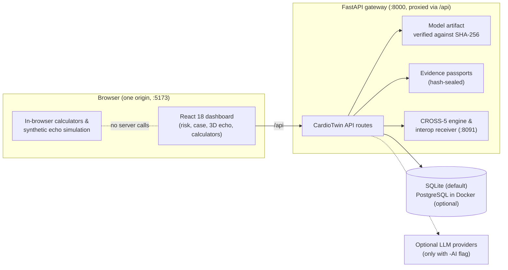
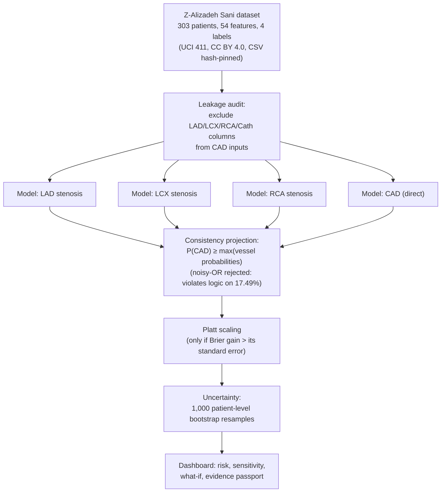

# CardioTwin

**Developed by Victor von Doom** · Co-authored by Mistral Vibe

CardioTwin is a cardiology decision-support research prototype. It estimates the risk of coronary artery disease (CAD) and of stenosis in each major coronary artery from routine clinical data, states the uncertainty of every estimate, traces each figure to its inputs, and teaches echo anatomy interactively. It is not a medical device and is not validated for clinical use.

---

## The hidden problem: four labels inside a one-label dataset

Almost every published model on the Z-Alizadeh Sani dataset (UCI id 411) answers one question: *does this patient have CAD, yes or no?* The dataset contains 303 patients and 54 routine features — demographics, risk factors, symptoms, ECG, echo and labs — plus **four angiographically verified labels per patient**: the overall catheterisation result and, separately, whether the **LAD**, **LCX** and **RCA** arteries are stenotic. The standard workflow throws three of those four labels away.

That is the hidden problem CardioTwin targets: **not "is there disease", but "which artery is involved" — answered from the routine, non-invasive data a clinician already has**, before any catheterisation. Angiography answers it definitively, but it is invasive and is only performed after a decision has already been made. The per-artery question is what actually drives that decision (which territory to image, which lesion to expect), and it is buried inside a dataset that everyone else reduces to a single binary column.

The repository's own evaluation artifact (`cardio-engineering/core/backend/app/cardiotwin/artifacts/evaluation.json`) makes the cost of ignoring this visible:

| Question | Answerable from routine data? | Evidence |
| --- | --- | --- |
| "Does the patient have CAD?" | Well — ROC-AUC **0.913** (95% CI 0.876–0.944) | Direct model, 3×5 repeated stratified CV |
| "Is the LAD narrowed?" | Moderately — ROC-AUC **0.823** (0.776–0.868) | Same protocol |
| "Is the RCA narrowed?" | Barely — ROC-AUC **0.738** (0.682–0.788) | Same protocol |
| "Is the LCX narrowed?" | Poorly — ROC-AUC **0.679** (0.615–0.734) | Same protocol |

The aggregate answer is close to solved. The vessel-level answer is an open problem hiding in the same rows — and the gap between those two rows of the table (0.913 vs 0.679) is the problem statement. CardioTwin ships the vessel-level models **with their weakness stated** rather than hiding behind the single CAD number, because 302/303 rows of this dataset confirm that CAD *is* vessel disease: the overall label is true exactly when at least one target vessel is stenotic.

### Two traps hidden in the same data

1. **The leakage trap.** The dataset's own `LAD`, `LCX`, `RCA` and catheterisation columns nearly determine the CAD label. A model that includes them scores near-perfect on CAD while learning nothing clinically usable. CardioTwin's leakage audit excludes all four from the CAD inputs, and the exclusion is recorded in the evaluation artifact.
2. **The consistency trap.** Probabilities must obey `P(CAD) ≥ max(P(LAD), P(LCX), P(RCA))`. A noisy-OR combination scores marginally higher (ROC-AUC 0.9161 vs 0.9121) but violates this logical constraint on **17.49%** of patients — a model that says "no CAD" while calling an artery stenotic. CardioTwin ships max-projection instead, which guarantees the constraint at a cost of −0.0006 ROC-AUC, and both figures are published side by side.

### The hidden factors: each artery has a different routine signature

Standardised coefficients from the shipped models (same evaluation artifact) show the per-artery signal is not the aggregate signal with a different label — it is a different fingerprint in ordinary clinical data:

| Factor (routine data) | LAD | LCX | RCA |
| --- | --- | --- | --- |
| Typical chest pain | **+0.43** | +0.17 | +0.22 |
| Region RWMA (wall-motion abnormality on echo) | **+0.33** | — | — |
| Age | +0.31 | **+0.20** | +0.29 |
| EF-TTE (ejection fraction) | −0.26 | — | — |
| Nonanginal chest pain | −0.19 | — | — |
| Poor R progression on ECG | — | — | **+0.21** |
| Diabetes | — | +0.08 | **+0.34** |
| ESR (inflammation marker) | — | — | **+0.24** |
| Serum sodium | — | **+0.11** | — |
| Creatinine | — | **+0.09** | — |
| Sex (male) | — | — | **+0.21** |

Reading the fingerprint: LAD disease surfaces as classic typical chest pain with a wall-motion abnormality in the LAD's echo territory. RCA disease instead surfaces through diabetes, inflammation (ESR) and poor R-wave progression on ECG. LCX disease — the weakest, most hidden target — leaves only faint traces in age, sodium and renal markers. This is exactly why LCX scores 0.679 while CAD scores 0.913: **the LCX hides.** No one sees this from the single-label view of the dataset, because the single-label view averages these fingerprints together.

An independent confirmation comes from the `cardioscope` module (see [NOTICE.md](NOTICE.md) for its license), which ran a separately governed, hash-sealed final holdout evaluation on 61 locked records that its models had never seen — protocol, folds and seeds sealed under SHA-256 before any outcome was decoded, with a permanent execution guard preventing a second attempt:

| Target | ROC-AUC | Accuracy | Recall |
| --- | --- | --- | --- |
| CAD | 0.9134 | 0.8525 | 0.9070 |
| LAD | 0.8474 | 0.7213 | 0.8485 |
| LCX | 0.6723 | 0.6066 | **0.2083** |
| RCA | 0.6976 | 0.6721 | **0.2857** |

The LCX/RCA recall is weak, and CardioTwin says so. A vessel-level tool that hides its weakest artery is not a tool; it is a liability. Reporting the weakness is the first step toward solving it.

---

## Healthcare use case

This use case comes from the code in this repository:

1. **Risk estimate from routine data.** The model in `cardio-engineering/core/backend/app/cardiotwin/` takes 54 inputs. They cover demographics, risk factors (diabetes, hypertension, smoking, family history, dyslipidemia), symptoms (typical chest pain, dyspnoea), ECG findings, echocardiographic findings (ejection fraction, regional wall-motion abnormality, valve disease) and laboratory values. It returns the probability of CAD and of stenosis in the LAD, LCX and RCA.
2. **Transparent reporting.** Each output reports the bootstrap intervals, the calibration method and the limitations recorded in the model artifact. The CAD output is projected so that P(CAD) is never lower than the largest of the three vessel probabilities.
3. **Hash-sealed evidence records.** Cases can be packaged as evidence passports with a hash seal. The passport states that hash integrity does not establish scientific truth.
4. **Echo education.** A 3D torso and heart show six probe positions (PLAX, PSAX, apical, subcostal, suprasternal and RV inflow), and the scan plane moves with each one. The ultrasound image is a deterministic synthetic cross-section, labelled as a simulation.
5. **Echo calculators.** Six calculators return the raw result of a formula, with worked examples and sources. They apply no clinical thresholds, because none are verified in this repository.
6. **Patient communication.** MedClear turns dense clinical notes into plain language and an action checklist. It runs offline.
7. **Emergency-response demonstration.** Pulse 911 is a voice-first emergency dispatch simulation. It is a demonstration, not a validated triage tool.

**Intended users:** cardiology clinicians and trainees, and researchers. **Not intended** for patient-care decisions.

---

## Architecture

The architecture diagram PDF is [docs/submission/CardioTwin_Architecture.pdf](docs/submission/CardioTwin_Architecture.pdf). The same system, drawn inline:



The prediction pipeline, from the hidden four-label data to the transparent output:



- The browser uses one origin, `http://localhost:5173`. The Vite dev server proxies `/api` and `/mcp` to the FastAPI gateway on port 8000. The browser does not contact port 8000 or the interop receiver (port 8091) directly.
- The gateway runs the CardioTwin model (its artifact is checked against a SHA-256 hash), the evidence passports, the CROSS-5 API and the interop receiver.
- The database is a SQLite file by default. With `-Database postgres` it is PostgreSQL in Docker.
- The calculators, the synthetic case and the probe simulation run in the browser.
- The LLM providers are called only when the launcher is started with `-AI`.

---

## What the demo shows

| Route | What it does | Status |
| --- | --- | --- |
| `/platform` | Launchpad for every section | Working |
| `/cardiotwin` | 3D torso, heart and probe with a synchronised synthetic echo | Working. Educational simulation. |
| `/cardiotwin/calculators` | Six echo calculators with worked examples | Working |
| `/cardiotwin/case` | Evidence-linked synthetic case: measurements, uncertainty, what-if changes, CROSS-5 status | Working. Synthetic data. |
| `/cardiotwin/risk` | CAD risk prediction, sensitivity and model trust | Working |
| `/hub` | Overview of the module projects | Overview works. Per-module status badges are not implemented. |
| `/medclear` | Plain-language summaries of clinical notes | Working |
| `/pulse` | Pulse 911 emergency copilot studio | Simulation |
| `/cross5` | CROSS-5 multiscale intersection engine | Experimental |

---

## Technical stack

| Layer | Technology |
| --- | --- |
| Risk model | Python 3.12, scikit-learn logistic regression, NumPy |
| Backend API | FastAPI 0.115, Uvicorn 0.32, Pydantic 2.9 |
| Dashboard | React 18.3, TypeScript 5, Vite 6, React Router 7 |
| 3D | Three.js 0.169, React Three Fiber 8.17, Drei 9.114 |
| Pulse 911 app | React 19, Vite, Tailwind CSS v4 |
| MedClear | Python 3.12 |
| Tests | pytest (backend), Vitest 4 (dashboard) |
| Data stores | SQLite (default), PostgreSQL in Docker (optional) |
| Launcher | PowerShell (`start.ps1`) |
| Optional AI | Anthropic SDK 0.39 (Claude). OpenRouter and AWS Bedrock are alternative routes. |

---

## AI/ML model

**Model ID:** `cardiotwin-lr-multivessel`, version 1.0.0. The definition is in `cardio-engineering/core/backend/app/cardiotwin/`. The evaluation record is `artifacts/evaluation.json`.

- **Outputs.** The probability of CAD (any target-vessel stenosis), and the probability of stenosis in the LAD, LCX and RCA.
- **Algorithm.** L2-regularised logistic regression from scikit-learn, one model per output. Regularisation strength is chosen by inner 5-fold cross-validation.
- **Consistency rule.** The shipped CAD output uses max-projection, so P(CAD) is at least the largest vessel probability. In the evaluation this changes the CAD ROC-AUC by −0.0006.
- **Calibration.** Platt scaling was adopted for all four outputs, under a rule that requires the Brier improvement to exceed its standard error.
- **Uncertainty.** Reported intervals come from 1,000 patient-level bootstrap resamples. A bootstrap ensemble gives per-patient spread. The shipped artifact has no held-out calibration set for conformal prediction, so it makes no coverage guarantee.
- **Leakage control.** LAD, LCX, RCA and the catheterisation label are excluded from the CAD inputs. Those labels nearly determine the CAD label.
- **Training data.** The Z-Alizadeh Sani extension dataset (UCI id 411): 303 patients, CC BY 4.0. It is single-centre data from the Shaheed Rajaei Cardiovascular Center, Iran. There is no external validation.

**Out-of-fold results** (3 × 5 repeated stratified cross-validation; 95% intervals from 1,000 patient-level bootstrap resamples):

| Output | ROC-AUC (95% CI) | Other figures |
| --- | --- | --- |
| CAD, direct model | 0.913 (0.876–0.944) | PR-AUC 0.961 (0.938–0.979); Brier 0.103 (0.081–0.125); ECE 0.054 |
| CAD, shipped (max-projected) | 0.912 | Enforces the vessel consistency rule |
| LAD | 0.823 (0.776–0.868) | |
| LCX | 0.679 (0.615–0.734) | Weakest of the four outputs |
| RCA | 0.738 (0.682–0.788) | |

**What these results do not show.** They come from one centre and have not been tested externally. Calibration was estimated on the same sample. Discrimination for the LCX and RCA is modest. Performance in other populations is unknown.

**Use of an LLM.** The risk model does not use an LLM. When the launcher is started with `-AI`, the platform can call Claude Sonnet 4.6 (`claude-sonnet-4-6`) through the Anthropic API, or through OpenRouter (`anthropic/claude-sonnet-4.6`) or AWS Bedrock. The case page's narrative uses fixed templates and does not call an LLM.

---

## Data

- **Clinical dataset:** the Extension of Z-Alizadeh Sani dataset (UCI id 411), licensed CC BY 4.0. The code checks the file against a pinned SHA-256 hash. The citation is in [NOTICE.md](NOTICE.md).
- **Demonstration cases:** synthetic and deterministic. The demonstration does not need real patient information.

---

## How to run

**Prerequisites:** Windows PowerShell 5.1 or later, Python 3.12, and Node.js 20 or later. Docker Desktop is needed only for `-Database postgres`.

```powershell
git clone https://github.com/victrvondoom/CARDIOTWIN.git
cd CARDIOTWIN
python -m pip install -r cardio-engineering\core\backend\requirements.txt
Copy-Item .env.example .env     # optional: only needed for live AI
.\start.ps1
```

The launcher prints one link, `http://localhost:5173/platform`, and opens it in a browser. It also prints a synthetic demo sign-in for localhost. That sign-in is not a production credential.

| Flag | Default | Meaning |
| --- | --- | --- |
| `-Database sqlite` | yes | Synthetic, deterministic data in a local file. No Docker needed. |
| `-Database postgres` | | PostgreSQL in Docker Desktop. Start Docker Desktop first. |
| `-Port <n>` | `5173` | Dashboard port on localhost |
| `-AI` | off | Enables live AI calls. Needs provider keys in `.env`. |
| `-NoBrowser` | off | Starts without opening a browser window |

**Troubleshooting**

| Symptom | Fix |
| --- | --- |
| `cannot import name 'apply_configuration' from 'pypdf'` | `python -m pip install pypdf==6.19.0` |
| The port is already in use | `.\start.ps1 -Port 5180` |
| `-Database postgres` cannot connect | Start Docker Desktop, then run the launcher again |
| The dashboard loads but API calls fail | Keep the launcher window open. The API gateway runs there. |

---

## Demo video

**PENDING.** The 15–20 minute unlisted YouTube video has not been recorded or uploaded yet. When it is ready, replace this line with:

`Demo video: https://youtu.be/<video-id>`

Suggested outline, about 19 minutes:

1. Problem and healthcare use case (2 min)
2. Launch with `.\start.ps1` and tour `/platform` (2 min)
3. 3D heart: probe positions and the synthetic echo (3 min)
4. Calculators: worked example for aortic stenosis continuity (2 min)
5. Evidence-linked case: a what-if change and its uncertainty (3 min)
6. Risk model: metrics, calibration and limits (3 min)
7. MedClear and Pulse 911 (2 min)
8. Architecture, licensing, limitations and next steps (2 min)

---

## Open-source license

- **Original work:** MIT License, Copyright (c) 2026 Victor von Doom. See [LICENSE](LICENSE).
- **Third-party components:** data, assets and module folders keep their own licenses. [NOTICE.md](NOTICE.md) lists each one, its license and its required notice.
- **No unlicensed third-party code is published:** module folders without a license were excluded and are not part of this repository.

---

## Tests and verification

Results from the last recorded runs. The source is [docs/implementation/progress.md](docs/implementation/progress.md).

| Area | Result |
| --- | --- |
| Dashboard type check (`tsc`) | 0 errors |
| Dashboard unit tests (Vitest) | 439 of 460 pass. 21 tests in 7 files fail. These failures predate this work. |
| Probe geometry and echo simulation | 36 tests pass |
| Calculator formulas and registry | 42 tests pass |
| Evidence-linked case model | 15 tests pass |
| Backend CROSS-5 tests | Pass (subset run with `-k cross5`) |
| MedClear | 2 of 2 pass |
| **Not yet run** | Full backend pytest suite. Layout checks at 390 px and 768 px. Production build after the final navigation edits. Launcher re-run with the final code. |

---

## Limitations and safety

- This is a research prototype. It is not a medical device and is not CE-marked or FDA-cleared.
- The model has not been validated externally and was trained on single-centre data. Its intervals describe sampling uncertainty, not performance in other hospitals.
- Outputs are not diagnoses. Any use in care needs clinician review and confirmatory testing, such as angiography or CT, as appropriate.
- The vessel-level outputs, especially LCX and RCA, are weak. They are published as open problems with stated uncertainty, not as usable predictors.
- The 3D heart and the echo simulation are educational. Their two clocks are not frame-locked.
- The calculators give raw values only. No clinical thresholds are applied.
- Pulse 911 is a simulation, not a validated triage system.

---

## Repository layout

```
CARDIOTWIN/
├── start.ps1                  one launcher for the whole repository
├── LICENSE                    MIT (original work)
├── NOTICE.md                  third-party licenses and module status
├── README.md                  this file
├── .env.example               environment template, secrets left blank
├── docs/submission/           architecture diagram and presentation (PDF)
├── cardio-engineering/
│   ├── core/                  FastAPI backend and React dashboard
│   ├── modules/               licensed module project folders (see NOTICE.md)
│   └── docs/
├── medclear/                  MedClear plain-language engine
└── pulse/                     Pulse 911 application
```

---

## Acknowledgements

- UCI Machine Learning Repository, and Alizadehsani, Roshanzamir and Sani, for the Z-Alizadeh Sani dataset extension.
- Human Reference Atlas and HuBMAP (CCF 3D Reference Object Library), for the heart model.
- Database Center for Life Science, Japan (BodyParts3D), for the anatomy meshes.
- SlicerHeart contributors (BSD 3-Clause).
- The authors of the MIT-licensed module folders listed in [NOTICE.md](NOTICE.md).
